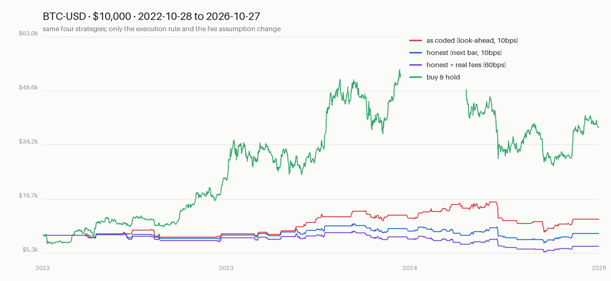

# espero

A small, honest crypto research harness: causal indicators, next-bar fills, and tests that fail
the moment you cheat.

## Why this exists

I inherited a 12,000-line trading bot. It looked complete — data layer, risk manager, order manager,
ML ensemble, paper trading. It had never placed a trade. The live path had no exchange client wired
into it, both entry points called methods that didn't exist, the only real order code talked to an
API Coinbase shut down in 2023, and the backtester filled at the *open* of the bar whose *close*
produced the signal.

That last bug was worth 38 percentage points of imaginary return. ([Full audit](docs/AUDIT.md).)

This repo is what was left after deleting everything that couldn't be trusted: one honest backtest
loop, four strategies, and a test suite whose job is to make the same mistakes impossible.

## What it does

- **Causal indicators** — 20/50 SMA, RSI(14), Bollinger(20, 2σ), MACD(12, 26, 9), all computed from
  past data only, with a test that proves it by recomputing every value on a truncated series.
- **Two execution models** — `next_bar` (signal at close *i*, fill at open *i+1*) and `same_bar`
  (the original bug), so the size of the look-ahead is measurable instead of assumed.
- **Costs that bite** — per-side fees and slippage from the command line; gaps through the stop fill
  at the open, not at the stop.
- **Numbers pinned in CI** — `tests/test_reference.py` asserts the audit's published figures against
  the committed dataset. Change the engine, and the claims break loudly.
- **Point-in-time features** — funding rates (Hyperliquid, OKX) and prediction-market odds
  (Polymarket CLOB) land in SQLite with two timestamps: when the data is *about* and when it could
  first have been read. `features.attach()` refuses to use a feature that is younger than the bar it
  would explain. The funding-extreme factor is wired into the signal stack and only fires when the
  column exists.
- **Paper trading with a spine** — `espero paper` runs the same signal code against live Coinbase
  candles, fills on the next bar's open (never the bar that produced the signal), writes every
  signal/order/fill/equity mark to SQLite, and resumes the open position after a restart. A risk
  gate sits under the strategy: max 25% of equity per position, 1% risk per trade, daily loss cap.

## The home screen

`espero` with no arguments opens an interactive screen: the two accounts and the last run's health on
top, an arrow-key menu below (status, dashboard, a no-write preview of what each rule would decide now,
history, run the daily job, deposit, pause, log, the single-coin loop, the factor table, tests). Needs
the `tui` extra: `pip install -e ".[chart,tui,dev]"`. Everything on the menu is also a plain command.

## The fast screen

Hypothesis #9b measured hourly reversal in crypto at t = 14 and 4 bps per three hours: a real effect
the size of the bid-ask bounce, which is the market-maker's income, not a forecaster's. So the fast
work in this repo is execution, not prediction. `espero fast` reads Coinbase's public book every
second, simulates resting post-only orders pessimistically (queue position, fills only from prints,
no price improvement), and proposes orders a human confirms with Enter, with the measured edge, the
venue's cost and the signal's recent IC on the same line. Paper only. The book can be recorded and
replayed at any speed, which is how it is tested and practised. Details: `espero/book.py`,
`execution.py`, `fast.py`, and [research/RESULTS_LEADLAG2.md](research/RESULTS_LEADLAG2.md).

## The degen drawer (打板)

One experiment with free rein, hypothesis #10: the Chinese retail playbook of hitting the board.
`espero degen scan` ranks the top 60 Coinbase altcoins by 24-hour volume on a cross-sectional score
of last-hour return, volume surprise and range expansion; a coin that prints a new 4-hour high on a
2-sigma volume spike is a candidate. `espero degen paper` runs that rule on live 5-minute bars with
up to three positions, every stop, trail and target in units of the coin's own ATR (so SOL gets a
wider stop than BTC without anyone choosing it), entries at the next open, the venue's taker fee.
`espero degen backtest` replays the last 30 days through every venue's fees. The rules and the five
pass criteria were committed before any candle was fetched:
[research/PREREGISTRATION_DEGEN.md](research/PREREGISTRATION_DEGEN.md). Paper only, no key.
**Backtest verdict: FAIL**, and not on fees: [research/RESULTS_DEGEN.md](research/RESULTS_DEGEN.md).

## Running unattended

The product is the two paper accounts. `espero daily` marks both, rebalances when each one's calendar
says so, rewrites the dashboard and a `health.json`, and a launchd agent runs it every morning:

```bash
./scripts/install-launchd.sh         # 07:30 local, state in the repo root, logs in ~/Library/Logs/espero
cat health.json                      # last_run, last_success, per-step ok / error / equity
touch KILL                           # pause everything; rm KILL to resume
```

Each step is isolated (a Yahoo failure in one account does not stop the other or the dashboard), a
pid lock prevents overlapping runs, the exit code is non-zero on any failure, and macOS notifications
(plus an optional webhook, `ESPERO_WEBHOOK_URL`) fire on failures and rebalances. The XS account
refuses to rebalance when fewer than 30 of its 42 coins have a fresh close, because a shrunken
universe would silently change the top-10. The whole operating procedure is in
[docs/RUNBOOK.md](docs/RUNBOOK.md).

## Live trading — EXPERIMENTAL, off by default, and paranoid when on

`espero live` connects to a real Coinbase Advanced account and can place real orders. It is a dry-run
tool with a trapdoor, not a product: it has never been reconciled against a venue, and it is not part
of the scheduled run. The October 2026 audit fixed four bugs in it (the daily loss limit never reset,
the risk gate was fed constants instead of the day's P&L, SELL signals were ignored so live ran a
different rule from the one that was tested, and the exit fee was not charged). Four things
must all be true before a single order leaves the process:

1. `.env` contains a CDP key pair (never commit it — `.env` is gitignored; `.env.example` lists
   every variable the repo reads, Hyperliquid testnet settings included)
2. `ESPERO_ALLOW_LIVE=1` is set
3. `--confirm-live` is passed
4. no `KILL` file exists in the working directory

Without `--confirm-live` the bot runs as a **dry run**: it reads your real balance and price, decides
what it *would* do, and logs it. Orders are also hard-capped by `--max-notional` (default $25) and the
process halts itself for the day at `--max-daily-loss` (default $15). Every order carries a
`client_order_id` generated before the call, so a retry is deduplicated instead of doubling.

```bash
cp .env.example .env      # fill in COINBASE_API_KEY and COINBASE_API_SECRET (or _SECRET_FILE)
espero live               # dry run: reads the account, sends nothing
espero live --loop --interval 60

# only after the dry run looks right, and only if you can afford to lose it:
ESPERO_ALLOW_LIVE=1 espero live --confirm-live --max-notional 25 --max-daily-loss 15
touch KILL                # stops the loop on its next pass
```

Honest limits of this version: stops are **software** stops checked once per bar, not exchange-side
orders — if the process dies, the stop dies with it. There is no reconciliation against the venue
yet, no partial-fill handling, and no funding. Fills are market orders at bar close, not the next
bar's open the backtest assumes; the journal records both so the difference is measurable.

## What it does not do (yet)

No reconciliation against a venue on boot, no exchange-side stop orders, no funding, no partial
fills. That is deliberate: those belong *below* the strategy layer, and the roadmap adds them with
tests instead of adding them as decoration. See [Roadmap](#roadmap).

## Factor research

`RESULTS_XS20.md` diagnosed why the cross-sectional tests kept failing: one factor, no risk control,
no turnover control, no breadth. The toolkit the cross-sectional shops actually run on is now in the
package, written to this repo's rules (every operator causal and tested, the forward return computed
in one named place, nothing wired into a live account without a pre-registration):

```bash
espero factors                        # rank-IC table of the zoo on the 42-coin panel
espero factors --horizon 10 --names mom_30,rev_3,lowvol_30
python research/multifactor.py        # hypothesis #8, as pre-registered
```

| module | what it is |
|---|---|
| `ops.py` | Alpha101/191 operator dialect: `ts_rank`, `ts_corr`, `decay_linear`, `cs_rank`, `cs_neutralize`, MAD winsorizing |
| `panel.py` | wide OHLCV panel; eligibility dated by history and dollar volume, not by what exists today |
| `factors.py` | twelve signed factors, three literal Alpha101 formulas, a rank-average composite |
| `factor_eval.py` | rank IC, ICIR, t, IC decay, quantile spread, turnover, purged walk-forward, deflated Sharpe, the Harvey-Liu-Zhu t > 3 hurdle |
| `portfolio.py` | vol targeting, weight caps, turnover buffer, ex-ante book vol |
| `tca.py` | per-trade cost, annual turnover and drag, on the dashboard |

What it deliberately does not include: breadth beyond 42 survivors, machine-learned factor weights
(not enough independent observations to fit one honestly), intraday data, shorting.

## Quickstart

```bash
python -m venv .venv && source .venv/bin/activate
pip install -e ".[chart]"          # numpy + pandas (+ Pillow for charts)

espero matrix                      # the audit table on the committed BTC-USD data
espero backtest --fee-bps 60       # one configuration, honest fills
espero chart                       # docs/equity.png
espero paper                       # one step of paper trading on live candles
espero paper --loop --interval 60  # keep it running (ctrl-c to stop)
espero tsmom --cash 100            # cross-asset trend paper account
espero dashboard --open            # one self-contained HTML page with the accounts

espero fetch ETH-USD --days 1460   # fresh data, no API key needed
espero matrix data/ETHUSD_86400s.csv
```

Run the tests:

```bash
python -m unittest discover -s tests -t . -v
```

Or run the whole CI job locally — the same steps as `.github/workflows/ci.yml`, no hosted runner
needed:

```bash
./scripts/check.sh --install     # first time
./scripts/check.sh               # tests + audit table + CLI smoke test

./scripts/install-hooks.sh       # optional: run the checks on every git push
```

## One factor, tested honestly

Funding-rate extremes looked like an edge: on Hyperliquid BTC, funding below z = −2 was followed by
+0.585% on the next day (63% hit, n = 60), and the same rule on ETH returned +28% over the 2025–26
holdout while holding lost money.

Then the longer history arrived. On Deribit's seven years of funding (2019–2026), the identical rule
produced **25 trades, +17.2%, t = 0.91** — no evidence of edge — and the selection period before the
holdout showed nothing at all.

The full write-up, including why a fixed z-threshold cannot be shared across venues (Deribit's funding
std is 8× Hyperliquid's), is in [research/FINDINGS.md](research/FINDINGS.md). The short version: it
was a regime, not a law, and it is not traded by anything in this repo.

A second hypothesis — cross-sectional momentum, [pre-registered](research/PREREGISTRATION.md) before
the data was touched — did the same thing from the other direction: +115% CAGR in the design period,
then **−29.75% CAGR on the holdout** against +23.3% for buying BTC. Two hypotheses, two honest
failures, both written down: [research/RESULTS.md](research/RESULTS.md).

The third failed too (Polymarket liquidity provision — rewards don't cover inventory:
[research/LP_NOTES.md](research/LP_NOTES.md)).

The fourth **passed**: cross-asset time-series momentum over SPY/TLT/GLD/USO/BTC/ETH, pre-registered
before its data was fetched. On the 2021–2026 holdout it returned +7.26% CAGR with a **−8.15% max
drawdown against −14.56%** for equal-weight — less money, much less pain, including +1.6% in 2022 when
long bonds fell 30%. The paper is [here](research/RESULTS_TSMOM.md). It is a drawdown-control result,
not an income one, and the Sharpe margin (1.08 vs 1.02) is inside noise.

The fifth, PEAD on 60 large caps with SEC timestamps, **failed**: −1.64% CAGR and Sharpe −0.05 on the
holdout against SPY's +13.4% and 0.84 — it lost in the design period too. 5,351 filings, a clean
point-in-time design, and no edge in the most scrutinised pond on earth:
[research/RESULTS_PEAD.md](research/RESULTS_PEAD.md).

The sixth, crypto-policy odds as a composite signal, **failed** too: Spearman +0.024 across 422
observations, and the top-vs-bottom quintile spread ran the wrong way. The design period turned out to
be empty — Polymarket's history for these markets starts in December 2023 — which is a flaw in how the
periods were set: [research/RESULTS_ODDS.md](research/RESULTS_ODDS.md).

The seventh, top-5-of-21 crypto momentum, was exploratory by construction (its window was already
contaminated) and showed that selection added nothing over equal weight:
[research/RESULTS_XS20.md](research/RESULTS_XS20.md).

The eighth, the first built from the factor stack — a rank-average of 30-day momentum, 3-day reversal
and low volatility, top 10 of 42, vol-targeted to 20% and turnover-buffered — **passed** all four
pre-registered criteria on its (weakened) holdout: +16.9% CAGR, Sharpe 0.92, −24% max drawdown
against BTC's +10.7%, 0.45, −53%. The information-only decomposition says what kind of pass it is:
ten coins chosen *alphabetically* with the same construction already beat BTC on Sharpe and
drawdown, the extra return comes from the low-vol factor, and momentum contributes nothing. The IC
criterion was met by a composite whose mean quantile spread is *negative*, a flaw in the criterion as
written that the results file records: [research/RESULTS_MF.md](research/RESULTS_MF.md).

The ninth, BTC lead-lag into altcoins on hourly bars, failed twice: once by construction (the
unscaled gap has the same ranks as plain reversal, caught before any data was fetched) and once on
the data (the beta-scaled version does not beat reversal, and the 4 bps spread is the bid-ask bounce):
[research/RESULTS_LEADLAG2.md](research/RESULTS_LEADLAG2.md).

The tenth, 打板 altcoin breakout chasing on 5-minute bars, failed on the data: 180 trades in 30 days,
28% hit rate against a 40% break-even, and a loss *before fees*. Half the stops were gaps on the bar
after the fill: the 2-sigma volume bar is the climax, and the rule buys it. The scanner stays; the
rule does not: [research/RESULTS_DEGEN.md](research/RESULTS_DEGEN.md).

The eleventh is the first that does not predict anything: delta-neutral funding carry on Hyperliquid
(short the perp, hold the spot, collect what longs pay). The hedge held (1.5% max drawdown, funding
paid 4% of funding received) and the income was real, but fees took 55% of it, mostly from the
rule's own churn, and the 2023–24 premium regime that would have cleared the bar is gone: +5.2%
annualised against the 8% required, −7% on Kraken fees. FAIL, closest of anything since #8:
[research/RESULTS_CARRY.md](research/RESULTS_CARRY.md). `espero carry scan` stays as the view of
what shorts are being paid today; development against Hyperliquid runs on its testnet
(`HL_NETWORK=testnet`, UI at app.hyperliquid-testnet.xyz), market data from mainnet, and nothing
in the repo signs an order there.

The twelfth is #11 with the two fixes its post-mortem named, pre-registered as post-hoc: swap a
held coin only for one paying 5 points more and only after a week, and rest maker orders on both
legs. Swaps fall from 55 to 6, fees from 3.15% to 0.14% of equity, and the rule clears all five
criteria: +10.9% annualised, Sharpe 1.77, +6.4% on Kraken maker fees. The pass is provisional on
its own terms (post-hoc, and maker fills assumed at the close) and earns a 30-day forward paper
test, not a conclusion: [research/RESULTS_CARRY2.md](research/RESULTS_CARRY2.md). That test is
running (`espero carry paper`, two books on live hourly funding, one at taker and one at maker
costs, 2026-10-28 → 2026-11-27).

Scoreboard: thirteen tests, three passes. Two are risk construction; the third is income (carry at
maker fees) with a forward test still attached. No predictive edge has been found at any horizon.

## The numbers

BTC-USD, 2022-10-28 → 2026-10-27, 1,461 daily bars, $10,000, one long position.

| Case | Return | CAGR | Sharpe | Max DD | Trades |
|---|---|---|---|---|---|
| as coded (look-ahead), 2% notional, 10 bps | −0.15% | −0.04% | −0.48 | −0.24% | 11 |
| honest, 2% notional, 10 bps | +0.05% | +0.01% | 0.33 | −0.06% | 7 |
| as coded (look-ahead), full size, 10 bps | **+42.95%** | +9.34% | 0.52 | −42.7% | 43 |
| honest, full size, 10 bps | **+5.23%** | +1.28% | 0.17 | −39.4% | 40 |
| honest, full size, **60 bps** | **−29.07%** | −8.23% | −0.28 | −50.7% | 40 |
| buy & hold | **+289.08%** | +40.45% | — | — | — |



Same signals every row. The only things that change are when the fill happens and what it costs.

## Design rules

1. **A strategy emits `Signal` objects and nothing else.** It cannot size a position, read the
   account, or call a broker. Everything that can lose money sits below it and is testable offline.
2. **A fill happens after the signal.** There is a test for this, and a second test that pins the
   difference between honest and cheating.
3. **Costs are explicit.** Fee per side, in basis points, on the command line. No hidden 10 bps.
4. **Gaps are real.** If the bar opens through your stop, you get the open.
5. **The published numbers are a test fixture.** If they move, one of us is wrong.

## Layout

```
espero/
  espero/
    data.py         # Coinbase/Yahoo/FRED fetches with retries and a cached fallback
    indicators.py   # causal SMAs, RSI, Bollinger, MACD
    signals.py      # four strategies + weighted combiner (pure functions)
    backtest.py     # one position, one bar at a time, two fill models
    journal.py      # SQLite: bars, signals, orders, positions, equity
    risk.py         # pre-trade gate: size, exposure, daily loss cap
    paper.py        # simulated loop: closed bar -> signal -> next-bar fill -> journal
    broker.py       # Broker protocol, Coinbase Advanced adapter, DryRun wrapper
    live.py         # EXPERIMENTAL: real orders, capped and gated, same signals
    tsmom.py        # monthly cross-asset trend paper account
    xs.py           # weekly cross-sectional crypto paper account, degraded-universe guard
    cash.py         # where idle cash lives, and why
    runner.py       # `espero daily`: tsmom -> xs -> dashboard -> health.json, lock, notifications
    notify.py       # macOS notification + optional webhook
    dashboard.py    # static HTML, with TCA per account
    ops.py          # Alpha101/191 operators, causal
    panel.py        # wide panel + dated eligibility
    factors.py      # the factor zoo
    factor_eval.py  # rank IC, purged walk-forward, deflated Sharpe
    portfolio.py    # vol targeting, caps, turnover buffer
    tca.py          # transaction cost analysis
    report.py       # the matrix table and the equity chart
    cli.py          # fetch | backtest | matrix | chart | paper | live | tsmom | xs | factors | daily | dashboard
  tests/            # 141 tests
  deploy/launchd/   # the LaunchAgent template; scripts/install-launchd.sh renders it
  research/         # one pre-registration and one results file per hypothesis
  data/             # committed BTC/ETH daily candles so the numbers reproduce offline
  docs/AUDIT.md     # the audit that started this
  docs/AUDIT_2026-10.md  # the second audit: what broke on a bad day, and the factor stack
  docs/RUNBOOK.md   # install, check, pause, recover
```

## Roadmap

- [x] Causal indicators + honest backtester + reference tests
- [x] Walk-forward split with a purge gap; report out-of-sample only (`factor_eval.purged_walk_forward`)
- [x] Position sizing as risk: vol targeting and caps (`portfolio.py`), not yet wired to a live account
- [x] SQLite journal: bars, signals, orders, fills, positions, equity
- [x] Restart-safe paper trader on live candles, with a pre-trade risk gate
- [x] Broker interface behind one protocol, with `client_order_id` idempotency
- [x] Live path with dry-run, kill switch, notional cap and daily loss limit
- [ ] Reconciliation against a real venue on boot
- [ ] Exchange-side stop orders (so the stop survives a crash)
- [ ] Kill switch: daily loss cap, max open risk, max orders/minute
- [x] TCA report per paper account (`tca.py`, on the dashboard)
- [x] Scheduled run with health file, lock and notifications (launchd; Docker not needed for a Mac)
- [x] Retrying HTTP with a cached fallback; degraded-universe guard
- [ ] Dated listing/delisting file, so survivorship can be measured instead of disclosed
- [ ] Forward paper account for hypothesis #8, if it passed

The gate for live money is not "it backtests well". It is: two weeks of paper at zero duplicate
orders, a restart mid-position that reconciles to the cent, and out-of-sample results that survive
your actual fee tier.

## Docs

- [docs/AUDIT.md](docs/AUDIT.md) — the original audit: what was broken, how it was measured, and the
  30-day plan this project is executing.
- [docs/AUDIT_2026-10.md](docs/AUDIT_2026-10.md) — the second audit: ten findings, five money bugs
  fixed, the deployment gaps closed, and what a factor shop would add.
- [docs/RUNBOOK.md](docs/RUNBOOK.md) — running it unattended on a Mac.
- [docs/CHEATSHEET.md](docs/CHEATSHEET.md) — the two commands you need, and the drawers you don't.

## License

MIT. Research and education only. Not financial advice; this software can lose money, and the
default configuration will.

Closes nothing automatically, promises nothing, and has no opinion about what happens next.
