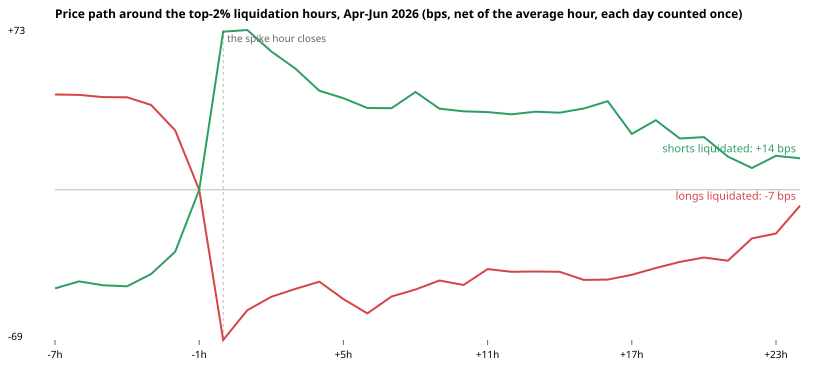
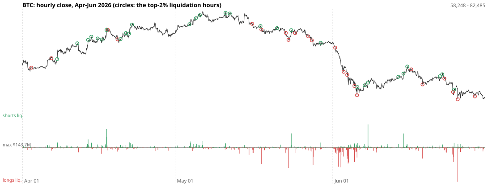

# Exploration — liquidations against price, April–June 2026 (aggr's hourly bars)

**Not a test.** Exploration made to suggest a rule, on data split in advance. Nothing here is a
finding until a pre-registered test on the sealed months confirms it.

Script: [aggr_explore.py](aggr_explore.py). Output: [aggr_explore_run.txt](aggr_explore_run.txt).
Charts and the spike list: [aggr_explore/](aggr_explore/).

## The data and the split

aggr's public server (`api.aggr.trade`, from github.com/Tucsky/aggr-server) keeps hourly bars from
2026-04-01 with the dollars of shorts liquidated (`lbuy`) and longs liquidated (`lsell`) in each.
It records 14 of our coins: BTC, ETH, SOL, BNB, XRP, ADA, DOGE, AVAX, LINK, TRX, LTC, XLM and HBAR on
Binance futures (most also on Bybit and OKX) and SHIB on OKX. Price and volume come from Binance
futures (SHIB from OKX); liquidations are summed over every venue a coin trades on. It is one
person's free server: the whole download was 28 requests, 3 seconds apart, saved in `data/aggr/`.

The months were split **before anything was looked at**:

- **explored**: April, May and June 2026 (2,184 hours a coin)
- **sealed**: July 1 → October 28, 2026, downloaded the same day so it cannot disappear from the
  server, never read. Its four files and their SHA-256 are in
  [aggr_holdout_manifest.json](aggr_holdout_manifest.json); a pre-registered test must find them
  unchanged.

## What was looked at

A **spike** is an hour in the top 2% of a coin's own hours by liquidation share (liquidations on
one side ÷ the hour's Binance volume), the first hour of each cascade (spikes within 6 hours of the
last are the same one). 400 long-liquidation spikes and 478 short ones, on 89 of the 91 days.

| after a spike in | n | the spike hour itself | +1h | +4h | +24h |
|---|---|---|---|---|---|
| **longs liquidated** (forced selling) | 400 | −71 bps | **+15 bps** (t 2.5) | **+29** (t 2.2) | **+65** (t 2.4) |
| **shorts liquidated** (forced buying) | 478 | +72 bps | +4 (t 0.6) | **−26** (t −2.6) | **−56** (t −2.6) |

Forward returns are net of the average hour (the market fell in these months: −26 bps a day on
average), each day counted once.

([ETH](aggr_explore/eth.svg), [SOL](aggr_explore/sol.svg), [DOGE](aggr_explore/doge.svg))

## What it suggests

**Forced flow reverts, on both sides.** Price slides for several hours into a long-liquidation
spike, bottoms at that hour's close, and climbs back about 60 bps over the next day. A short squeeze
does the mirror image: it peaks at the spike and fades over 4 to 24 hours. On the BTC chart the red
circles (longs liquidated) mostly sit at local lows and the green ones (shorts liquidated) at local
highs. It is the same direction #18 found (forced breaks fade more), the same reversal behind
"new 4-hour lows bounce" in #18's information table, and the fire-sale mechanism the
pre-registration cited: nobody chose those trades, and once they are done the price comes back.

The biggest single example: 2026-06-25 13:00, $144M of BTC longs liquidated in an hour that fell
4.85%. It was up 2.06% one hour later and 3.27% a day later.

## Why this is not a result

- **Six numbers were looked at** (two sides, three horizons), with t-statistics from 2.2 to 2.6:
  about what the best of six would be with nothing there plus a little luck.
- **Three months, one stretch of market**: BTC went from 68,288 (April 1) up to 82,485 in May and
  down to 58,605 by June 30, with most spikes in the June sell-off; mostly majors.
- **The spike threshold uses each coin's whole three months**, so it knew in April how big June's
  liquidations would be. A live rule must use only the past.
- **Feeds**: Binance's liquidation stream is sampled (at most one a second per coin), so its
  dollars are a lower bound, worst in exactly these cascades.

## The test this suggests, to be pre-registered before the sealed months are opened

- **Long-only, the tradable side**: buy a coin at the close of an hour whose long-liquidation share
  is in the top 2% of its trailing 30 days; hold 24 hours (4 hours as a second horizon). On July–
  October: mean excess return > 0 with t ≥ 3, each day counted once, in both halves of the period,
  and above the cost hurdle the other tests used.
- **The short-squeeze fade** (short at the close of a top-2% short-liquidation hour) as information
  only: this account does not short; Hyperliquid would be paper.
- Side by side with #20 (new 4-hour lows on volume, price only, on Binance's unused days): if both
  pass, they are probably one effect; if only the liquidation version passes, the liquidations
  carry information the price alone does not.
